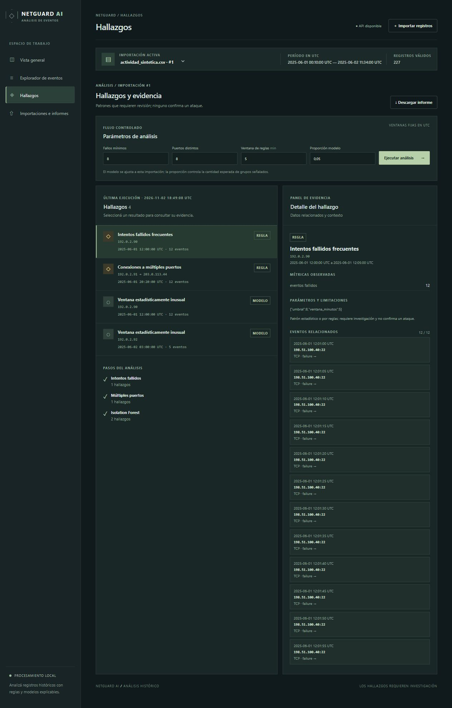

# NetGuard AI

Consola local de investigación de registros históricos de red. Importa CSV, valida y normaliza eventos, permite explorarlos y genera hallazgos explicables mediante reglas e Isolation Forest. Los resultados son señales para investigar, no ataques confirmados. No captura tráfico, escanea redes ni bloquea sistemas.



## Funcionalidades

- Vista previa de CSV con filas aceptadas y motivos de rechazo; importación transaccional.
- Indicadores por hora UTC, protocolo y puertos; búsqueda, ordenamiento y paginación de eventos.
- Dos reglas configurables y un modelo local con evidencias asociadas a sus eventos.
- Informe HTML y resultados JSON del último análisis; eliminación confirmada con borrado asociado.
- Datos sintéticos incluidos y funcionamiento sin conexión ni servicios de pago.

## Arquitectura y requisitos

FastAPI sirve una interfaz HTML/CSS/JavaScript sin compilación. Python procesa los CSV con su biblioteca estándar y NumPy; Scikit-learn ejecuta Isolation Forest. SQLite se eligió por su instalación sencilla y persistencia local, sin un servidor adicional. El esquema se crea automáticamente al arrancar (`PRAGMA user_version=1`); no hay migraciones automáticas para futuras versiones. Las consultas usan parámetros y el ordenamiento admite una lista de campos permitidos.

Requisitos: Python 3.11, pip y navegador moderno. Se verificó con Python 3.11.9; rangos de dependencias en `requirements.txt`. Docker y Docker Compose son opcionales.

## Ejecutar en Windows sin Docker

En PowerShell, dentro de la carpeta del proyecto:

```powershell
cd "$env:USERPROFILE\Desktop\6sixP\NetGuard AI"
py -3.11 -m venv .venv
.\.venv\Scripts\python.exe -m pip install -r requirements.txt
.\.venv\Scripts\python.exe -m uvicorn netguard.app:app --host 127.0.0.1 --port 8082 --no-access-log
```

Abrí http://127.0.0.1:8082/ y detené el servidor con `Ctrl+C`. Si el puerto está ocupado, elegí otro, por ejemplo `--port 8083`. La base se crea en `data/netguard.db`; para cambiarla, definí `NETGUARD_DB` antes de iniciar. `NETGUARD_MAX_MB` establece el límite de archivo en MiB (predeterminado 5, entre 1 y 50). `.env.example` muestra las variables: no se carga automáticamente.

## Docker (alternativa)

Instalá Docker Desktop con Compose, iniciá Docker y ejecutá:

```powershell
cd "$env:USERPROFILE\Desktop\6sixP\NetGuard AI"
docker compose up --build
```

Abrí http://127.0.0.1:8080/. `docker compose down` detiene el servicio y conserva el volumen `netguard-data`. El puerto solo se publica en `127.0.0.1`. Para borrar datos concretos, usá **Eliminar** en la aplicación; esa acción también borra sus análisis y evidencias. Para reiniciar **todos** los datos del contenedor, primero respaldá lo necesario y ejecutá `docker compose down --volumes`: elimina el volumen de este proyecto. Sin Docker, detené la aplicación y borrá `data/netguard.db` solo si querés eliminar todas sus importaciones. Docker no estaba instalado en el entorno de desarrollo, por lo que estos comandos no pudieron verificarse aquí.

## CSV

UTF-8 con encabezado y extensión `.csv`, máximo 5 MiB por defecto y 25.000 filas. Columnas obligatorias: `timestamp`, `source_ip`, `destination_ip`, `destination_port`, `protocol`. Opcionales: `source_port`, `action`, `bytes`.

```csv
timestamp,source_ip,destination_ip,source_port,destination_port,protocol,action,bytes
2025-06-01T12:00:00Z,192.0.2.90,198.51.100.10,49152,443,TCP,failure,120
```

Fechas ISO 8601 con `Z` o desplazamiento explícito; se convierten a UTC. Sin zona horaria se rechazan. IP válidas IPv4/IPv6, puertos de 0 a 65535, protocolos TCP/UDP/ICMP, bytes enteros no negativos. Acciones admitidas: `allow`, `deny`, `success`, `failure` y `unknown`; si falta se usa `unknown`. Campos opcionales ausentes quedan vacíos. Se rechazan duplicados normalizados **dentro del mismo archivo**; se permite importar de nuevo el mismo archivo como una importación separada. No se interpreta ni ejecuta contenido del CSV.

La vista previa muestra la cantidad y motivos por línea. Podés guardar las filas válidas aunque existan rechazadas; estas últimas conservan número de línea y motivo, no el registro original. Si ocurre un error al guardar, la transacción revierte todos los cambios. El archivo original no se guarda; el gestor de subida puede utilizar archivos temporales del sistema durante la petición y los libera al finalizar.

## Demostración y flujo de investigación

1. Abrí **Importaciones e informes** y seleccioná **Usar dataset sintético de ejemplo**.
2. Revisá la vista previa y elegí **Guardar**. En la vista general se muestran las cifras reales.
3. En **Explorador de eventos**, aplicá filtros por fechas UTC, IP exacta, puerto o protocolo; ordená, paginá y abrí un evento. Restablecé para quitar filtros.
4. En **Hallazgos**, configurá umbrales y pulsá **Ejecutar análisis**. Seleccioná un resultado para ver métricas, parámetros y eventos vinculados.
5. Descargá el **informe HTML** o los **resultados JSON**. El informe contiene referencias a los identificadores de hallazgos; el detalle de evidencia se consulta en la aplicación. La API también ofrece `/docs` para explorar sus rutas.

`examples/actividad_sintetica.csv` contiene 227 eventos generados sin registros reales: actividad variada, 12 fallos de `192.0.2.90`, 12 puertos distintos para otra pareja de IP y un grupo con volumen de bytes inusual. Las direcciones son rangos reservados para documentación. `examples/validacion_mixta.csv` contiene una fila válida y cuatro inválidas. Se regeneran con `python scripts/generate_examples.py`.

## Reglas y modelo

- **Intentos fallidos frecuentes:** cuenta `failure` y `deny` por IP de origen en ventanas fijas UTC; umbral predeterminado 8 en 5 minutos. Sin columna `action` o acciones conocidas se omite y se informa.
- **Múltiples puertos:** cuenta puertos de destino distintos por par origen/destino en la misma ventana; umbral predeterminado 8. La evidencia corresponde a los eventos de ese grupo.

Las ventanas son intervalos fijos alineados a la época Unix; un patrón que cruza un límite puede dividirse. Cero hallazgos y paso omitido se muestran de forma distinta. Cada ejecución guarda sus parámetros, pasos y versión del motor.

El modelo se ajusta por importación sobre grupos de IP de origen y hora UTC, sin usar identificadores como características. Emplea cantidad de eventos, destinos y puertos distintos; si están disponibles añade proporción de fallos y bytes totales. Acciones desconocidas cuentan como no fallidas y bytes faltantes como cero; si una columna está totalmente ausente se omite su característica. Se requieren 20 grupos y variación en dos características. Isolation Forest usa 100 árboles, semilla 42 y contaminación 0,05 por defecto (configurable entre 0,01 y 0,30). La contaminación ajusta la proporción esperada de grupos señalados, no la probabilidad de ataque. Una puntuación `decision_function` menor indica mayor anomalía relativa. Sin datos suficientes se informa y no se inventan resultados. Los resultados y versiones quedan guardados, pero pueden variar entre versiones de Scikit-learn: usá la versión registrada para reproducirlos. No existen métricas de precisión sin etiquetas evaluadas.

El flujo automatizado es controlado: validar, guardar, ejecutar reglas y, cuando corresponde, el modelo, registrar pasos y descargar un informe local. No es un agente autónomo general. La evidencia muestra hasta 200 eventos por hallazgo; el explorador permite consultar el resto. La gráfica temporal muestra hasta las primeras 1.000 horas con actividad.

## Fuentes públicas

La demostración funciona sin conexión con datos sintéticos. No se distribuye ni preconfigura un dataset público: el conjunto [Internet Firewall Data de UCI](https://archive.ics.uci.edu/dataset/542/internet+firewall+data) no incluye las IP y marcas temporales requeridas por este formato. Un adaptador para fuentes públicas compatibles queda como mejora futura; no se inventan campos faltantes.

## Privacidad y límites

Todo se procesa localmente; el flujo principal no envía registros a servicios externos. No hay proveedor de IA generativa ni credenciales. La configuración recomendada escucha solo en localhost, sin CORS habilitado para otros orígenes y sin registro de acceso en el comando documentado. No existe autenticación ni cifrado de la base: cualquiera con acceso a la aplicación o al archivo SQLite puede consultar los datos. No está preparada para despliegue empresarial ni para exponerla a Internet. Evitá usar registros sensibles en equipos compartidos. La eliminación en cascada retira eventos, rechazos, ejecuciones y evidencias de la base, pero no garantiza borrado seguro del disco o de respaldos.

## Pruebas y automatización

```powershell
.\.venv\Scripts\python.exe -m pytest -q
.\.venv\Scripts\python.exe -m compileall -q netguard
```

Las pruebas usan bases y datos sintéticos temporales. Cubren validación, transacciones, reglas, ventanas, modelo, evidencia, filtros, informes y eliminación. Se verificaron 13 pruebas con Python 3.11.9. El flujo de GitHub Actions instala dependencias, regenera ejemplos, ejecuta pruebas, comprueba el arranque y construye la imagen Docker; se ejecutará al publicar el repositorio, no fue ejecutado en este equipo. El JavaScript no requiere compilación; se puede validar su sintaxis con `node --check static/app.js` si Node está instalado. La revisión manual verificó vistas de escritorio y pantalla estrecha, importación sintética, hallazgos y vista previa de rechazos; no reemplaza una auditoría completa de accesibilidad.

## Problemas frecuentes

- **Puerto ocupado:** cambiá `--port` y abrí el nuevo puerto en el navegador.
- **No se conecta la API:** mantené la terminal del servidor abierta y revisá su mensaje de error.
- **Archivo rechazado:** comprobá UTF-8, encabezados, tamaño, fechas con zona horaria y rangos de IP y puerto. La vista previa indica cada motivo.
- **Modelo omitido:** se necesitan al menos 20 grupos de origen/hora y variación suficiente; revisá el resumen de pasos.
- **Docker no responde:** iniciá Docker Desktop o usá la instalación sin Docker.

## Mejoras futuras

Migraciones versionadas, adaptadores para datos públicos compatibles, paginación del panel de evidencia, controles de acceso y evaluación con datos etiquetados. Estas funciones no están implementadas.

## Guion para entrevista

Presentá el problema de analizar logs históricos; mostrá la validación y el rechazo de filas; filtrá un origen y recorré una regla hasta sus eventos; compará una anomalía estadística con una regla determinista; explicá por qué SQLite y procesamiento local facilitan el despliegue y cuáles son sus límites; terminá con pruebas, privacidad y mejoras pendientes.
